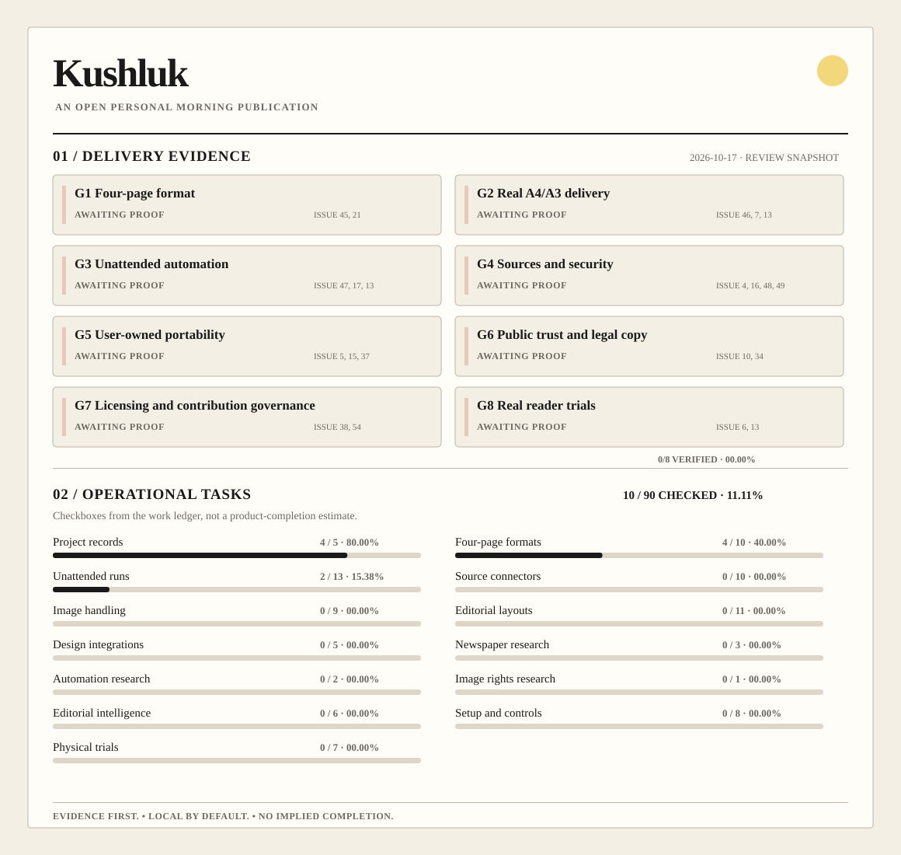
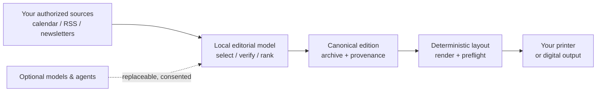

<div align="center">


### Welcome to Kushluk

**A small newspaper, assembled from the sources you choose, ready for your morning.**

[](https://github.com/interzettel/kushluk/actions/workflows/ci.yml)
[](https://github.com/interzettel/kushluk/actions/workflows/project-health.yml)
[](LICENSE)
[](pyproject.toml)
[](docs/STATUS.md)

[What works](#what-works-today) · [Make an edition](#make-an-edition) · [Feature & releases](docs/FEATURE_CATALOG.md) · [Research](docs/research/newspaper-ecosystem-2026-10-17.md) · [Progress](#development-and-progress) · [GitHub Project](https://github.com/orgs/interzettel/projects/3) · [Contribute](#contributing) · [Project decisions](#decisions-and-trust)

</div>

Kushluk is **local-first, print-first personal publishing software**. It gathers useful signals from your day and information sources you are entitled to access, selects what matters, and assembles a finite edition that you can read away from the screen. It is **not** a news subscription, a hosted library of other publishers' articles, or an AI-generated feed to scroll forever.

The canonical publication has **four logical DIN A4 pages**, composed once and available through separate physical print profiles. **DIN A4 and US Letter** are the two recommended home-printer formats; A3 folding is optional:

| DIN A4 at home | US Letter at home | Optional A3 folded | Without a printer |
| --- | --- | --- | --- |
| Four A4 pages on two duplex sheets, or simplex | Four true 8.5 × 11 in pages, proportional scaling from canonical A4 | Two landscape sides, folded into four A4 pages | Locally saved HTML/PDF and optional configured email |

**Important:** that four-page architecture is an **accepted design decision**, not a claim about the code shipped today. The Stage 1 software now renders **four logical A4 pages** and validates their page count, order, and A4 dimensions. True A4/Letter geometry and A3 imposition have software tests. Actual A4/Letter/A3 paper output, unattended delivery, readability and device acceptance remain separately tracked.

## Where the name comes from

**Kushluk** is our internationally readable spelling of the Turkish word *kuşluk*, meaning **mid-morning**, the time between morning and noon. Older Oghuz Turkish sources already record the term. It is commonly associated with *kuş* (“bird”) and the hour when birds become active, although its precise linguistic derivation has been debated. The name suggests a quiet, observational moment of the day—not a technology or news-company brand.

Etymological background: [Turkish Language Association research on *kuşluk*](https://tdk.gov.tr/wp-content/uploads/2019/01/01.D%C4%B0VAN%C3%9C-LUGAT%C4%B0%E2%80%99T-T%C3%9CRK%E2%80%99TE-ANLAMI-PROBLEML%C4%B0-BAZI-C%C3%9CMLELER-VE-S%C3%96ZC%C3%9CKLER-%C3%9CZER%C4%B0NE-son-bi%C3%A7im-.pdf). The Turkish spelling appears here only to explain the word's origin; **the product name is always Kushluk**.

## The idea

A newspaper is useful partly because it **ends**. Kushluk applies that editorial discipline to your own calendar, RSS feeds, newsletters and other eligible sources.

- **Today first.** Useful commitments and practical orientation take priority over noisy breaking-news widgets.
- **For you, with room for surprise.** Editorial relevance and serendipity matter more than maximizing engagement.
- **Your sources, your edition.** Personal source selections, archive and preferences live with you by default.
- **AI is optional infrastructure.** Providers and agents can assist research and editorial decisions; approved templates and print geometry remain deterministic.
- **The paper is real.** Duplex settings, folds, margins, reading comfort, ink use and offline recovery matter.

No proprietary model subscription or Kushluk-operated account should be required for the basic engine. Optional model API calls, external connectors, printers and email services can have their own costs or terms. Rights to subscribed material are **not** transferred by using this software.

## What works today

<details open>
<summary><strong>In the executable Stage 1 prototype</strong></summary>

- Python package, `kushluk` CLI and runtime health check.
- Weather via Open-Meteo, RSS/Atom stories and a generic ICS calendar (with local fixture fallback).
- Canonical candidates, source-aware story clustering, ranking and an optional lead story.
- Four canonical A4 HTML pages with ordered IDs, optional validated WeasyPrint PDF and distinct A4, **US Letter** and advanced A3 printable variants; Letter uses proportional fit, not editorial reflow.
- Local Markdown/JSON/HTML archive, with PDF when validated.
- CUPS printer discovery/submission, SMTP delivery and configured email-on-print-failure.
- Accessible local home setup with saved A4/Letter paper choice, and read-only source/printer preflight.
- Opt-in macOS/Linux local failure notification submission with fixed private-data-safe text; no default notification or automatic retry.
- Existing pytest/Ruff and GitHub Actions smoke checks.

</details>

| Accepted, **not yet shipped** | Still exploratory / open |
| --- | --- |
| A4-home and A3-folded physical print profiles | Advanced physical interlocks, origami and paper-afterlife designs |
| Unattended, idempotent morning run and stable agent operations | Fluid animated digital edition, specialist design-tool adapters |
| Media rights/asset manifest and deterministic multi-page layout archetypes | Optional hosted print/storage businesses and original public magazine series |
| Explicit newsletter discovery and private source modes | License changes, foundation governance and optional sponsorships |

This is an early open-source prototype. Check the [status report](docs/STATUS.md) for implementation detail before depending on a feature.

## First installable preview (M1 candidate)

The `kushluk` **wheel and source distribution** can now be built reproducibly and clean-installed on Linux (Python 3.11/3.12) and macOS (Apple Silicon/Intel) in CI. The installed `kushluk preview` command produces a **fixed, fictional, four-page** publication without any RSS, weather, inbox, private profile, printer or SMTP connection:

```bash
python -m pip install build
python -m tools.release_check --artifact-dir output/m1-preview
# Or, after installing a built wheel in a clean environment:
kushluk preview --output-dir ./synthetic-preview
# For PDF, install the [pdf] extra and supported native Pango dependencies:
kushluk preview --output-dir ./synthetic-preview-pdf --pdf
```

[Preview install instructions, supported platforms and limitations](docs/PREVIEW_INSTALL.md) · [M1 release checklist](docs/RELEASE_PLAN.md). The first **experimental GitHub source-only prerelease** is published: **[Kuşluk v0.2.0-alpha.1](https://github.com/interzettel/kushluk/releases/tag/v0.2.0-alpha.1)** (Python package version `0.2.0a1`), at annotated tag commit `d90f9a5ea0a65e7e9393675fd82cefb7e2d4159c`. The release provides verified first-party wheel/sdist and SHA256SUMS; independent CI checks and a live dependency advisory audit passed for that source SHA. There is no PyPI release, bundled native fonts/binaries/PDFs or independently verified physical/reader acceptance. Temporary CI artifacts remain separate from the official GitHub prerelease. Four-page PDF checks are software evidence, not physical printing or real-reader acceptance.

## Make an edition

Requires **Python 3.11+**. Native **macOS (Apple Silicon and Intel)** setup, Pango/PDF installation, and CUPS printer commands are documented in the [Mac setup guide](docs/MACOS.md). Mac CI covers software behavior; physical printing still requires a real-machine trial.

Clone the actual public repository:

```bash
git clone https://github.com/interzettel/kushluk.git
cd kushluk
python -m venv .venv
source .venv/bin/activate     # Windows PowerShell: .venv\Scripts\Activate.ps1
python -m pip install -e ".[dev]"
kushluk doctor
kushluk generate --no-pdf
```

The last command generates an HTML edition and archives it locally. Live weather and RSS depend on network availability; missing sources are reported and safely degraded rather than silently fabricated. The sample calendar fixture supports initial exploration.

For optional validated PDF rendering:

```bash
python -m pip install -e ".[pdf]"
kushluk generate
```

By default, printing follows your **saved home paper choice** (DIN A4 or US Letter). The optional `--print-profile a4-home|letter-home|a3-folded` overrides the saved format. Letter generates a distinct four-page **612 × 792 pt** PDF by fitting the original A4 design proportionally, while preserving the canonical archive; A3 uses two landscape booklet sides (`4|1` and `2|3`). These are software profiles. Real paper, duplex direction, type size and device margins still require physical trials.

Printing and email are **separately configured**. If a compatible local CUPS printer is available, use `kushluk generate --print`; for SMTP delivery use `kushluk generate --email`. Neither command makes a printer or mail account appear automatically. Read [onboarding](docs/ONBOARDING.md), the [macOS print/setup guide](docs/MACOS.md) when applicable, and [.env.example](.env.example).

**Configuration detail:** `.env.example` documents environment variable names; the Python application does **not** automatically load a `.env` file. Set/export the values in your shell or use a local secret manager. Never commit credentials or private editions.

For **local-only RSS subscription preview**, use `kushluk sources-import-opml subscriptions.opml --output private-sources.json`. It creates an unactivated, user-reviewable draft and **does not contact providers**; see [OPML guide](docs/OPML.md). Export using `kushluk sources-export-opml private-sources.json --output subscriptions-export.opml`.

For local crash recovery, `kushluk deliver-archived` resends **only the validated archived edition** with explicit acknowledgment and a unique request ID. It never fetches new sources or regenerates a page. Generate a hardware-test kit without printing via `kushluk print-proof --output-dir output/print-proof`; see [physical-print verification](docs/PRINT_PROOF.md).

To schedule local editions safely, use `kushluk run` and inspect `kushluk run-status`. The daily receipt prevents automatic duplicate printing or email submissions, including after interrupted delivery. Optional `kushluk notify-local --date YYYY-MM-DD --send` or `kushluk run --notify-local` submits one fixed local desktop alert for a failed incident when explicitly requested (not proof the user saw it). See [local notifications](docs/LOCAL_NOTIFICATIONS.md) and [native scheduling and launchd](docs/SCHEDULING.md). Full unattended-host acceptance is not yet complete.

Run checks before contributing:

```bash
ruff check src tests tools
pytest -q
python tools/project_health.py check
```

The progress command and its CI gate are part of the merged [engineering foundation PR #55](https://github.com/interzettel/kushluk/pull/55).

## Development and progress

[](docs/PROGRESS.md)

**Operational task progress and all eight separate release evidence gates are maintained in [the generated progress report](docs/PROGRESS.md).** Do not infer readiness from the task count or a successful synthetic package test.

**[Explore all 90 individual tasks and their current states](docs/PROGRESS.md#individual-tasks)** · [Master issue ledger #43](https://github.com/interzettel/kushluk/issues/43) · [Task-to-issue map](docs/ISSUE_CROSSWALK.md) · [Kushluk Project board](https://github.com/orgs/interzettel/projects/3) · [Board configuration #62](https://github.com/interzettel/kushluk/issues/62)

The [generated progress report](docs/PROGRESS.md) contains the current per-workstream table, all 90 task IDs, and eight separately evidence-gated delivery checks. It is regenerated from the work ledger; the README deliberately does **not** duplicate dated percentages that would quickly go stale.

We use a **solo-maintainer + assisted development** workflow, not recurring Scrum ceremonies. The natural hierarchy is **direction → milestone → work package → task → proof**. A new idea may stay under investigation; a bug fix needs a regression test; a shipped feature requires implementation and evidence. Completing research can mean rejecting an idea with reasons.

The graphic shows **two different things**: evidence gates G1–G8 and checked operational tasks. Neither is an overall product-completion percentage. No gate can be marked verified just because an issue is closed or a PR is opened.

| Record | Why it exists |
| --- | --- |
| [Master issue ledger #43](https://github.com/interzettel/kushluk/issues/43) | All issues, open and closed, with one primary workstream each |
| [WORK_LEDGER.md](docs/WORK_LEDGER.md) | Canonical existing implementation task IDs |
| [ISSUE_CROSSWALK.md](docs/ISSUE_CROSSWALK.md) | Canonical mapping for all 90 task IDs, merged through PR #53 |
| [PROGRESS.md](docs/PROGRESS.md) + [manifest](docs/progress-manifest.json) | Reproducible checklist counts and evidence gates |
| [Working method](docs/WORKING_METHOD.md) + [work journal](docs/WORK_JOURNAL.md) | New ideas, bugs, decisions, dated changes and reviewer handoffs |
| [ROADMAP.md](docs/ROADMAP.md) + [STATUS.md](docs/STATUS.md) | Product sequence versus demonstrated code |
| [ADRs](docs/adr/README.md) | Accepted, superseded and still-disputed architectural decisions |
| [First-run local setup](docs/LOCAL_SETUP.md) | Guided CLI, localhost-only home setup and per-feed OPML review; no accounts or automatic source activation |
| [OPML and source approval](docs/OPML.md) | Private source proposals, explicit individual RSS approval, revocation and legacy RSS environment behavior; no publisher redistribution grant |
| [Feature catalog](docs/FEATURE_CATALOG.md) + [release milestones](docs/RELEASE_PLAN.md) | 32 stable feature IDs mapped to epics, owner issues, evidence and proposed v0.2 preview / v1.0 stable release gates; planning [#87](https://github.com/interzettel/kushluk/issues/87) |
| [Upstream dual-review ballots](docs/REUSE_REVIEWS.md) | ChatGPT provisional positions, independently pending Claude review, explicit founder adoption decisions [#88](https://github.com/interzettel/kushluk/issues/88) |
| [Private beta operator trial](docs/BETA_PRIVATE_PILOT.md) | `kushluk pilot-kit --output-dir PRIVATE_DIR` creates private blank observation forms and a manifest; no real-world gate approval or hardware access |
| [Private beta operator trial](docs/BETA_PRIVATE_PILOT.md) | Read-only cross-check of actual A4, host/reboot, novice and source-permission receipts, with explicit independent-review and no-publish gates |
| [First-reader usability pilot](docs/FIRST_READER_PILOT.md) + [accessible second pilot](docs/ACCESSIBILITY_PILOT.md) | Independent U1–U6 novice and A1–A5 keyboard/screen-reader observation kits, private field completeness checks; no participant acceptance claimed |
| [M1 alpha candidate evidence](docs/M1_ALPHA_CANDIDATE.md) | Verified CI provenance, checksum-based per-install preflight and outstanding human signoff; no version bump, GitHub tag or release published |
| [Real-device field acceptance](docs/FIELD_ACCEPTANCE.md) | Operator self-reported, hashed private A4/Letter/A3 hardware, reader, and reboot evidence; physical and reader release gates still require independent review |
| [Native/font licence evidence](docs/DEPENDENCY_AUDIT.md) | Automated hashed pending-review worksheet per clean install; actual redistribution and font-embedding rights still need human review |
| [Print inspection evidence](docs/PRINT_INSPECTION.md) | PDF text-anchor/structural checks with optional private PNG previews, still requiring human visual and physical review |
| [Offline EPUB3 experiment](docs/EPUB.md) | Export archived semantic editions as four reflowable chapters; private, offline, reader-hardware validation remains open |
| [Newspaper ecosystem research](docs/research/newspaper-ecosystem-2026-10-17.md) + [25-project CSV matrix](docs/research/newspaper-project-matrix-2026-10-17.csv) | Categorized current source/code/license review, Goosepaper and RSSPub investigations, priority comparisons and evidence gaps under [#84](https://github.com/interzettel/kushluk/issues/84) |
| [Competitor/inspiration transfer policy](docs/UPSTREAM_REVIEW.md) | Durable decisions about adapting, rejecting or independently reimplementing ideas without copying upstream code |

To regenerate the SVG and Markdown on the progress-enabled branch:

```bash
python tools/project_health.py write
python tools/project_health.py check
```

The board uses Kushluk's paper-led palette, stays readable without color, and is checked in CI for deterministic output.

## How it works



The canonical edition is separate from the printer profile. Agents—including the proposed Grok, Hermes and Claude integrations—should call the **same stable interfaces**, not replace the publication model or acquire automatic access to private source data. Those interfaces are currently planned work, not certified bot integrations.

For deeper details see [architecture](docs/ARCHITECTURE.md), [editorial system](docs/EDITORIAL_SYSTEM.md), [data map](docs/DATA_MAP.md), [failure policy](docs/FAILURE_MATRIX.md) and [automation design](docs/FULL_AUTOMATION.md).

## Decisions and trust

**Source rights.** You control your generated files, local archive and your own original contributions. That does **not** transfer copyrights in third-party articles, newsletter text, photographs or fonts. Private copying, reassembly, printing and sharing depend on applicable rights, contracts and jurisdictions. Kushluk does not offer subscription circumvention or a central licensed-news catalog.

**Privacy.** The intended default is a reader-controlled personal data plane, not telemetry or centralized reading profiles. External weather/RSS/services still make their own network requests when enabled. Optional future cloud storage or printing requires its own disclosed consent, data flow and legal analysis.

**License.** The source code currently ships under **[MIT](LICENSE)**. A future MPL-2.0 core / Apache-2.0 interoperability split remains under [discussion #38](https://github.com/interzettel/kushluk/issues/38), not adopted. Separate artwork, subscription materials and official branding may have different rights; inspect [third-party notices](THIRD_PARTY_NOTICES.md).

**Name.** Write **Kushluk** using ASCII letters throughout the software, documentation and public product identity. Keep lowercase `kushluk` for the repository, package, CLI and environment variables. The original Turkish spelling appears only when explaining its etymology.

## Contributing

This project welcomes fixes, carefully scoped ideas, independent plugins, thoughtful editorial design and evidence-backed criticism. A contributor should be able to find one issue, make one small PR, run tests and understand what counts as complete.

Read [CONTRIBUTING.md](CONTRIBUTING.md), [SECURITY.md](SECURITY.md) and [AGENTS.md](AGENTS.md). The maintainers' current focus is making the existing engine robust: [four-page format #45](https://github.com/interzettel/kushluk/issues/45), [print profiles #46](https://github.com/interzettel/kushluk/issues/46), and [unattended local runs #47](https://github.com/interzettel/kushluk/issues/47), followed by [real morning-print trials #13](https://github.com/interzettel/kushluk/issues/13).

**Every new issue** follows the traceability contract in [AGENTS.md](AGENTS.md): issue type, labels, human assignee, project, milestone, relationships, development branch/PR and verified resolution. The [**Kushluk GitHub Project #3**](https://github.com/orgs/interzettel/projects/3) exists and already displays repository issues. Its status columns are Backlog, Ready, In progress, In review and Done. Additional native fields are covered by the [credential-gated Project automation](docs/PROJECT_AUTOMATION.md) ([#65](https://github.com/interzettel/kushluk/issues/65)); they are **not active until bootstrapped and verified**. Milestones, native relationships and fully checked historical coverage remain distinct follow-up work.

Kushluk is built to give the morning back to its reader.
