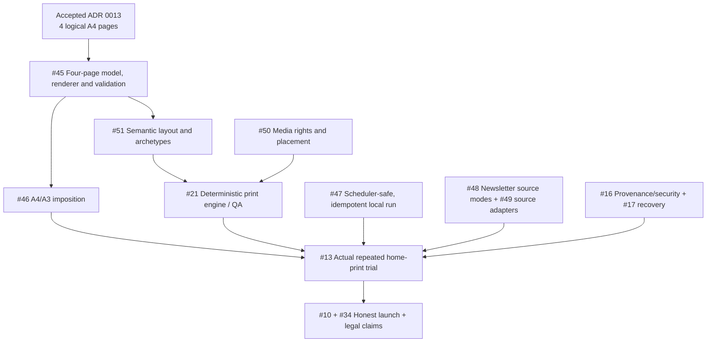

# Kushluk work-to-issue crosswalk

**Audit date:** 2026-10-16 · **Status:** merged documentation map ([PR #53](https://github.com/interzettel/kushluk/pull/53)); still not evidence that implementation tasks are complete.

This table maps every task identifier in [WORK_LEDGER.md](WORK_LEDGER.md) to a **single primary GitHub issue**. GitHub [master ledger #43](https://github.com/interzettel/kushluk/issues/43) indexes issue scope, state and dependencies. `WORK_LEDGER.md` remains the operational list of executable tasks and their checked/unchecked state. `STATUS.md` distinguishes implementation from plan. Accepted architecture decisions in `adr/` take precedence.

**Do not confuse:** a linked issue being OPEN does not mean a particular subtask is unimplemented; a subtask being checked in older docs does not prove a current working test. Verify code, CI, release artifacts or actual hardware evidence before changing the status. Closing a research issue as `rejected/not planned` can be a valid completed decision. This mapping is deliberately many-to-one to avoid flooding GitHub with 90 micro-issues; open PR-sized children if concrete work demonstrates need.

## Full task inventory — 90 tracked IDs

| Task IDs from WORK_LEDGER.md | Task count | Canonical issue | Additional context |
| --- | ---: | --- | --- |
| **DOC-01 to DOC-05** | 5 | [#44 Documentation reconciliation](https://github.com/interzettel/kushluk/issues/44) | DOC-01/02/03/05 are already checked in the original ledger; DOC-04 is the continuing synchronization task. Preserve checked state pending evidence review. |
| **FMT-01 to FMT-03** | 3 | [#45 Four-page canonical format and PDF validation](https://github.com/interzettel/kushluk/issues/45) | [#21 print engine](https://github.com/interzettel/kushluk/issues/21) is integration parent; accepted ADR 0013 |
| **FMT-04 to FMT-10** | 7 | [#46 A4/A3 imposition and hardware profiles](https://github.com/interzettel/kushluk/issues/46) | [#7 delivery](https://github.com/interzettel/kushluk/issues/7), [#13 real printing](https://github.com/interzettel/kushluk/issues/13) |
| **AUT-01 to AUT-13** | 13 | [#47 Unattended orchestration and recovery](https://github.com/interzettel/kushluk/issues/47) | AUT-06/07/08/11/13 are optional spikes; accepted **ADR 0015** mandates replaceable orchestrators; #5/#17/#20 integration |
| **SRC-01 to SRC-02** | 2 | [#48 Newsletter discovery/source modes](https://github.com/interzettel/kushluk/issues/48) | [#4 source rights](https://github.com/interzettel/kushluk/issues/4); resolve duplicate ADR 0012 records in #44 |
| **SRC-03 to SRC-10** | 8 | [#49 Other source adapters/verification](https://github.com/interzettel/kushluk/issues/49) | [#3 BYO AI/providers](https://github.com/interzettel/kushluk/issues/3); [#16 provenance/security](https://github.com/interzettel/kushluk/issues/16) |
| **IMG-01 to IMG-09** | 9 | [#50 Rights-aware media pipeline](https://github.com/interzettel/kushluk/issues/50) | [#21 print engine](https://github.com/interzettel/kushluk/issues/21) |
| **LAY-01 to LAY-11** | 11 | [#51 Deterministic semantic layout/archetypes](https://github.com/interzettel/kushluk/issues/51) | [#9 visual system](https://github.com/interzettel/kushluk/issues/9), [#31 runtime-AI critique](https://github.com/interzettel/kushluk/issues/31) |
| **DES-EXT-01 to DES-EXT-05** | 5 | [#52 Optional design-tool integration spike](https://github.com/interzettel/kushluk/issues/52) | Research only; no Canva/Adobe SaaS runtime dependency approved |
| **RES-NEWS-01 to RES-NEWS-03** | 3 | [#52 Print newsroom-workflow research](https://github.com/interzettel/kushluk/issues/52) | Findings should inform #51/#21, not create a commercial newsroom |
| **RES-AUTO-01 to RES-AUTO-02** | 2 | [#47 Local scheduling architecture review](https://github.com/interzettel/kushluk/issues/47) | Compare existing OS schedules vs workflows, not mandatory n8n |
| **RES-IMG-01** | 1 | [#50 Image rights policy](https://github.com/interzettel/kushluk/issues/50) | Coordinate #4/#34 for copyright and public/private publishing |
| **ED-01** | 1 | [#14 Editorial constitution/explainability](https://github.com/interzettel/kushluk/issues/14) | Morning-intent rationale, also accepted ADR 0014 |
| **ED-02** | 1 | [#14 Editorial constitution/explainability](https://github.com/interzettel/kushluk/issues/14) | Durable user model distinct from ephemeral intent |
| **ED-03** | 1 | [#6 Finite editorial experience](https://github.com/interzettel/kushluk/issues/6) | Story-thread continuity, archive identity under ADR 0010 |
| **ED-04** | 1 | [#14 Editorial constitution/explainability](https://github.com/interzettel/kushluk/issues/14) | Protected serendipity |
| **ED-05** | 1 | [#6 Finite editorial experience](https://github.com/interzettel/kushluk/issues/6) | Density modes, also compatible with #51 |
| **ED-06** | 1 | [#19 Reader feedback](https://github.com/interzettel/kushluk/issues/19) | Local-by-default feedback, external reporting only via explicit #18 |
| **UX-01** | 1 | [#5 Human/agent onboarding](https://github.com/interzettel/kushluk/issues/5) | Print capabilities, #46 adapter |
| **UX-02** | 1 | [#48 Newsletter discovery/source modes](https://github.com/interzettel/kushluk/issues/48) | Review controls, also #5 onboarding |
| **UX-03** | 1 | [#5 Human/agent onboarding](https://github.com/interzettel/kushluk/issues/5) | Source interests and language |
| **UX-04** | 1 | [#5 Human/agent onboarding](https://github.com/interzettel/kushluk/issues/5) | Pause/snooze/reprint control contract belongs #47 |
| **UX-05** | 1 | [#5 Human/agent onboarding](https://github.com/interzettel/kushluk/issues/5) | A4/A3 printer-profile selection, #46 |
| **UX-06** | 1 | [#20 Agent failure/remediation interface](https://github.com/interzettel/kushluk/issues/20) | Human-readable recovery, also #17 |
| **UX-07** | 1 | [#5 Human/agent onboarding](https://github.com/interzettel/kushluk/issues/5) | Usability validated through #13 physical trial |
| **UX-08** | 1 | [#7 Delivery](https://github.com/interzettel/kushluk/issues/7) | Future messaging adapter; do not require WhatsApp access |
| **TRIAL-01 to TRIAL-07** | 7 | [#13 Real-world proof](https://github.com/interzettel/kushluk/issues/13) | TRIAL-01/02/03 require real user host/hardware/provider permissions; no fabricated trial results |
| **TOTAL** | **90** | **All mapped** | No task IDs left unassigned in the 2026-10-16 WORK_LEDGER snapshot |

## Physical dependency / execution order

**First delivery goal:** make #45, #46 and #47 testable on the current locally runnable stack, then exercise #13. The rest improves source richness, presentation or commercialization without blocking that proof.

## Documentation conflict register (to resolve under #44)

1. **ADR 0012 duplicates:** `adr/0012-newsletter-discovery-and-source-modes.md` and `adr/0012-newsletter-discovery-and-ingestion-modes.md` both claim `Accepted`; they use slightly different mode names and the latter suggests a preferred default derivative mode. Do **not** silently choose or rewrite either. Maintainer decision required on canonical filename/wording and preserved supersession.
2. **ADR 0015 omitted:** `adr/0015-replaceable-orchestration-and-agent-runtime.md` says `Accepted`, but `adr/README.md` does not list it. Fix listing without changing accepted behavior.
3. **Stale snapshots:** `WORK_LEDGER.md` and `STATUS.md` dated 2026-10-07 predate many later decisions/issues. Preserve their tested Stage 1 implementation claims, and don't claim four-page migration is complete.
4. **Open decisions under-indexed:** `OPEN_DECISIONS.md` still mentions only production typeface and earlier format supersession; unresolved license, vault, commercial and reader-magazine options should be *linked as proposals*, not converted into accepted ADRs.
5. **Community docs not yet present:** contribution / security reporting policies are not in root `CONTRIBUTING.md`, `SECURITY.md` or `CODE_OF_CONDUCT.md`; propose them with accurate contact channels and contributor-rights decisions before publishing.
6. **Source-license drift risk:** `LICENSE`, README, `pyproject.toml`, THIRD_PARTY_NOTICES currently say MIT. #38 proposes alternatives, **not an authorized relicensing**.

## Maintenance requirements

- New work-ledger tasks: immediately assign task ID, primary issue, priority/status and verification condition; amend this table in same PR.
- New GitHub issue: index exactly once in #43 and parent/related issue; it need not be a new work-ledger implementation task if RFC only.
- On task completion: record PR, test/CI/physical evidence, actual date and any exceptions. Do not auto-check these 90 from the issue creation alone.
- Before publishing a version: reconcile `README.md`, `STATUS.md`, `WORK_LEDGER.md`, this map, `OPEN_DECISIONS.md` and accepted ADR references.
