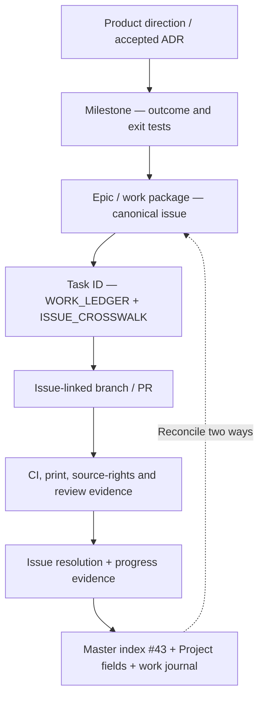

# Kushluk GitHub governance and reverse traceability

**Approved intent:** sole accountable maintainer with replaceable AI implementers; no compulsory Scrum rituals. **Configuration status:** the owner plans to create a GitHub Project named **Kushluk**. The live Project ID, native field definitions and milestones must be verified before attaching issues. [Setup and backfill #62](https://github.com/interzettel/kushluk/issues/62).

## Record model



## At issue creation

| Field | Rule | What can be automated today |
| --- | --- | --- |
| **Kind / native type** | Bug, Feature, Task, Research / Decision, with one primary kind | Templates encode kind; native issue types need repository capability verification |
| **Assignee** | `@yigit-denktas` by default; agent executor listed in description, never as fictional GH login | Issue templates set the maintainer account |
| **Labels** | Workstream, priority, maturity; only approved existing labels | Tooling can add existing labels; label creation/taxonomy remains #62 |
| **GitHub Project** | Add to real **Kushluk** project as soon as available; no invented Project URL | Pending owner creation and confirmation under #62 |
| **Project fields** | Stage, Priority, Workstream, Maturity, Evidence; use real option IDs only | Pending #62 |
| **Milestone** | Attach to a specific approved outcome/release when defined; otherwise mark `TBD` | No milestone objects were verified during this pass |
| **Relationships** | Parent, child, blocks and blocked-by on both sides | Markdown links always; native sub-issue/dependency API where available |
| **Development** | An implementation issue acquires an issue-linked branch and PR with `Refs #N` or `Closes #N` | Template + manual/agent check; research-only issues need not have a branch |

**Required issue-body metadata fallback** when project or native GitHub fields cannot be set:

```text
Kind:
Priority: P0 | P1 | P2 | P3
Workstream:
Maturity: idea | researching | decided | implemented | verified
Stage: inbox | exploring | ready | building | verifying | completed | parked
Assignee: @yigit-denktas
Project: Kushluk (pending #62 until verified)
Milestone: existing outcome milestone | TBD
Parent: #...
Blocks: #...
Blocked by: #...
Development: branch / PR | not started | not applicable
Evidence: URL / pending
```

## During development / closure

1. The issue is the durable hub. PR descriptions identify issue numbers, work-ledger task IDs, decision constraints, test cases and risk boundaries.
2. Link both directions: issue → PR/branch/verified evidence; PR → issue. Add native GitHub Development links when tooling and permissions allow.
3. **Completed:** only when outcome tests/physical demonstration match the acceptance criteria; close with `completed`, link merged PR and update G1–G8 **only** when full gate evidence exists.
4. **Duplicate:** first preserve any unique findings in canonical owner issue, cross-link, close with `duplicate` and update #43 and Project state. Duplicates earn no delivered-progress credit.
5. **Not planned / Parked:** record decision rationale and revisit trigger. A rejected experiment is valid research but not a delivered user feature.
6. Maintain issue inventory exactly once in [#43](https://github.com/interzettel/kushluk/issues/43) and task ownership in [ISSUE_CROSSWALK.md](ISSUE_CROSSWALK.md). Project board and issue ledger are connected records, **not magically synchronized** by the existing offline project-health script.
7. A maintainer or limited-authority agent audits open/closed issues after substantive activity, notices orphan PRs, unassigned issues, absent milestone, missing labels, stale progress claims and relationship mismatches.

## Minimal Project proposal

Start with five views: **Inbox**, **Ready**, **In progress**, **Blocked**, **Completed / parked**. Avoid sprint velocity, story points and daily meetings. Once the GitHub Project exists, track the five factual fields: Stage, Priority, Workstream, Maturity and Evidence. Prefer one named human steward and bounded coding-agent tasks to a fictitious team.

The canonical live GitHub Project URL and actual field options must be linked back to #62. Neither issue templates nor this document falsely claim that Projects, labels, issue types or milestones have already been configured.
