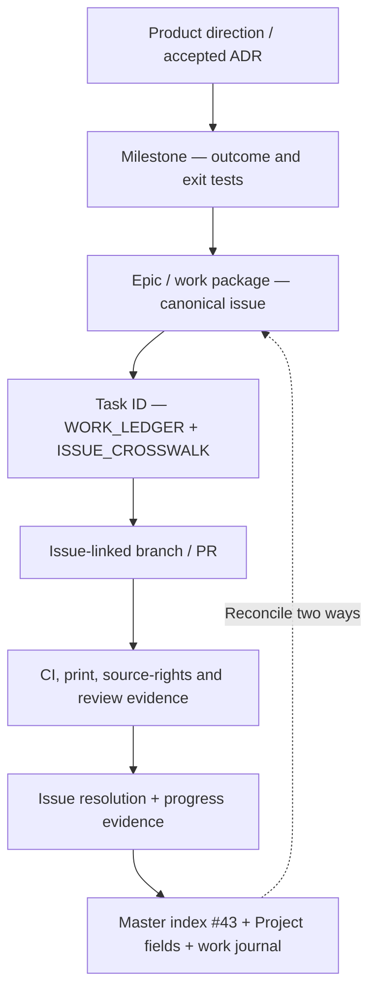

# Kushluk GitHub governance and reverse traceability

**Approved intent:** sole accountable maintainer with replaceable AI implementers; no compulsory Scrum rituals. **Configuration status:** the owner created the [**Kushluk GitHub Project #3**](https://github.com/orgs/interzettel/projects/3). The Project currently shows **56 Backlog items**, which numerically matches the open-issue count but has not been audited item by item. Native field definitions, Project write permissions and milestones still require verification. [Setup and backfill #62](https://github.com/interzettel/kushluk/issues/62).

## Record model



## At issue creation

| Field | Rule | What can be automated today |
| --- | --- | --- |
| **Kind / native type** | Bug, Feature, Task, Research / Decision, with one primary kind | Templates encode kind; native issue types need repository capability verification |
| **Assignee** | `@yigit-denktas` by default; agent executor listed in description, never as fictional GH login | Issue templates set the maintainer account |
| **Labels** | Workstream, priority, maturity; only approved existing labels | Tooling can add existing labels; label creation/taxonomy remains #62 |
| **GitHub Project** | [Kushluk / interzettel Project #3](https://github.com/orgs/interzettel/projects/3); verify each issue's membership | Actual board observed; full per-issue backfill audit pending #62 |
| **Project fields** | Existing **Status** is the canonical stage: Backlog / Ready / In progress / In review / Done. No extra Stage field. Proposed: Priority, Workstream, Maturity and Evidence; use real field and option IDs only | Native field inventory, edit permissions and values pending #62 |
| **Milestone** | Attach to a specific approved outcome/release when defined; otherwise mark `TBD` | No milestone objects were verified during this pass |
| **Relationships** | Parent, child, blocks and blocked-by on both sides | Markdown links always; native sub-issue/dependency API where available |
| **Development** | An implementation issue acquires an issue-linked branch and PR with `Refs #N` or `Closes #N` | Template + manual/agent check; research-only issues need not have a branch |

**Required issue-body metadata fallback** when project or native GitHub fields cannot be set:

```text
Kind:
Priority: P0 | P1 | P2 | P3
Workstream:
Maturity: idea | researching | decided | implemented | verified
Status: Backlog | Ready | In progress | In review | Done (actual GitHub Project Status)
Maturity: idea | researching | decided | implemented | verified (independent of Status)
Disposition: active | parked | rejected | duplicate (when relevant)
Assignee: @yigit-denktas
Project: https://github.com/orgs/interzettel/projects/3 (membership: confirmed | pending verification)
Milestone: existing outcome milestone | TBD
Parent: #...
Blocks: #...
Blocked by: #...
Development: branch / PR | not started | not applicable
Evidence: URL / pending
```

## During development / closure

1. The issue is the durable hub. PR descriptions identify issue numbers, work-ledger task IDs, decision constraints, test cases and risk boundaries.
2. Link both directions: issue → PR/branch/verified evidence; PR → issue. Add native GitHub Development links when tooling and permissions allow.
3. **Completed:** only when outcome tests/physical demonstration match the acceptance criteria; close with `completed`, link merged PR and update G1–G8 **only** when full gate evidence exists.
4. **Duplicate:** first preserve any unique findings in canonical owner issue, cross-link, close with `duplicate` and update #43 and Project state. Duplicates earn no delivered-progress credit.
5. **Not planned / Parked:** record decision rationale and revisit trigger. A rejected experiment is valid research but not a delivered user feature.
6. Maintain issue inventory exactly once in [#43](https://github.com/interzettel/kushluk/issues/43) and task ownership in [ISSUE_CROSSWALK.md](ISSUE_CROSSWALK.md). Project board and issue ledger are connected records, **not magically synchronized** by the existing offline project-health script.
7. A maintainer or limited-authority agent audits open/closed issues after substantive activity, notices orphan PRs, unassigned issues, absent milestone, missing labels, stale progress claims and relationship mismatches.

## Minimal Project proposal

The real board already provides **Backlog**, **Ready**, **In progress**, **In review**, **Done**, with Backlog, Priority board, Team items, Roadmap and My items views. Reuse these defaults. Consider a saved *Blocked* filter, not an unnecessary extra workflow stage. Avoid sprint velocity, story points and daily meetings. Review Priority, Workstream, Maturity and Evidence as additional fields only where they reduce ambiguity. Prefer one named human steward and bounded coding-agent tasks to a fictitious team.

The canonical [GitHub Project #3](https://github.com/orgs/interzettel/projects/3) is linked in #62 and #43. The Project exists; its full native field configuration, automatic workflows, issue types, approved labels, milestones and item coverage have **not** been verified by the currently connected issue/PR tools.
