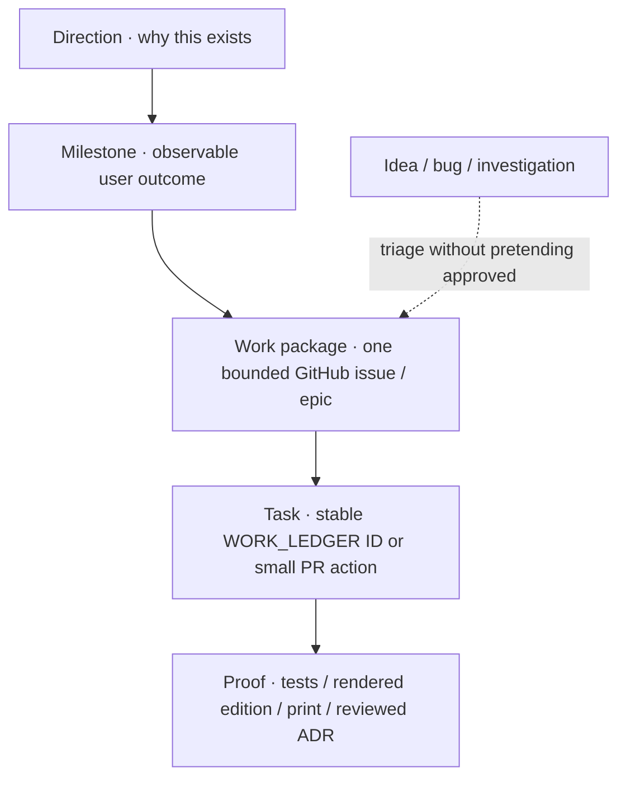

# How Kushluk work moves

**For one product steward and interchangeable development agents.** This is neither Scrum nor a claim that Kushluk is autonomously maintained.

## The hierarchy

These words are intentionally different:
- **Direction** is enduring intent (issue #2 and the product documents).
- **Milestone** is an actual demonstrable reader/developer outcome (e.g., a validated four-page printed morning).
- **Work package** is an issue with one owner and acceptance criteria. Broad epics coordinate multiple packages; they are not a new approval layer.
- **Task** is a small, stable work-ledger unit when work is actionable; ideas need not have a task ID immediately.
- **Proof** is a traceable result: merged commit, tests, generated artifact, documented physical print, or an explicit recorded rejection.

**Live [Kushluk GitHub Project #3](https://github.com/orgs/interzettel/projects/3):** its actual Status values are **Backlog → Ready → In progress → In review → Done**. The *Inbox* and *Exploring* concepts both live in **Backlog**, distinguished by type/maturity; *Building* maps to **In progress**, *Verifying* to **In review**, and *Completed* to **Done**. Parked/rejected are recorded as dispositions with explanations, not confused with delivered work. Proposed additional Project fields remain pending [#62](https://github.com/interzettel/kushluk/issues/62).

No sprint velocity, burndown games, story points, mandatory standups, or invented all-project percentages. The **single project coordinator** (human steward or delegated AI with limited permissions) maintains coherence and issue links; specialist agents make bounded branches/PRs and cannot independently claim completion or change their authorization.

## One intake → delivery path

| State | Meaning | Entry / exit test |
| --- | --- | --- |
| **Inbox** | A new idea, bug, finding or request | Link the original context, check existing issues |
| **Exploring** | Plausibility, risks, prototypes, alternatives | Adopt / reject / park with written reason |
| **Ready** | A bounded item with owner, dependencies and acceptance | Reproducible fixture/test and no silent policy blockers |
| **Building** | Someone is working on a scoped branch | One PR or small series, no parallel duplicate ownership |
| **Verifying** | Evidence exists and is being checked independently | CI, reviewer, hardware/source-rights evidence as applicable |
| **Completed** | Acceptance verified and authoritative records updated | Link merged change / accepted ADR / proved conclusion |
| **Parked** | Valid concept intentionally deferred, or rejected with reason | Preserve history and a revisit trigger; do not claim delivery |

Issues also have a **kind**: **idea**, **bug**, **research**, **decision**, **engineering**, or **maintenance**. GitHub's OPEN/CLOSED state is the transport, not the full semantic lifecycle. An issue closed as `not planned` is a recorded decision, **not a delivered feature**.

## How to record an idea, bug, or fix

**Idea:** Put the hypothesis and why it matters in the closest open discussion. A fresh issue is justified by a distinct question or separately testable outcome. It may stay Exploring for months without blocking the core.

**Bug:** Record reproduction, expected/observed result, environment, regression severity, sanitized logs and the privacy/print effect. The fix PR needs a test that fails before the fix and passes after. Record the resolution and any newly discovered adjacent risk.

**Feature:** Start with reader-visible outcome, accepted ADR constraints and smallest demonstration; assign task IDs if it becomes actionable. Record alternatives rejected and accept only verified work.

**Decision:** Major product, privacy, copyright, license or architecture changes require a proposed ADR/RFC and owner authorization. Neither PR merges nor agent confidence silently promote open research to policy.

**Change history:** One dated `docs/WORK_JOURNAL.md` entry or issue comment per substantive decision, merged change, incident and handoff; no need to log every keystroke or hold daily meetings.

## Authorities, no competing ledgers

| Question | Use |
| --- | --- |
| What exists in the portfolio? | [Issue #43](https://github.com/interzettel/kushluk/issues/43) (every GitHub issue once; snapshot manually reconciled) |
| Which executable task is checked? | [WORK_LEDGER.md](WORK_LEDGER.md) and [ISSUE_CROSSWALK.md](ISSUE_CROSSWALK.md) (merged via [PR #53](https://github.com/interzettel/kushluk/pull/53)) |
| What was actually built? | Source/tests, [STATUS.md](STATUS.md), CI and physical evidence |
| Has a higher-level reader outcome been proven? | [PROGRESS.md](PROGRESS.md) plus [progress-manifest.json](progress-manifest.json) G1–G8 |
| Why this constraint? | Accepted [ADRs](adr/README.md) and normative requirements |
| What changed or was learned recently? | [WORK_JOURNAL.md](WORK_JOURNAL.md) (dated links) |

## Agent coordinator / worker contract

The **steward** chooses priorities, authorizes spending and legal/policy changes, and can delegate specific issue-sized jobs. A coordinator agent may summarize the queue, detect duplicates, prepare PRs/decision alternatives, verify reports, and flag drift.

A **worker agent** (Claude, Grok, Hermes, OpenCog-based system or another runtime) can read the same public issue and accepted docs, perform scoped work and supply evidence. It has no implied authority to:
- access readers' private subscriptions/credentials or share generated editions;
- approve a change in license, trademark, paid hosting or publisher-rights claims;
- deploy, auto-merge, print physical documents, spend money or enable recurring API calls;
- grade its own outcome as accepted without an independently reproducible test or an explicit human decision.

Agent capability and future autonomy changes belong to [#56](https://github.com/interzettel/kushluk/issues/56). The **L0–L5 repository readiness model** is independent of product gates G1–G8 and combines with **R0–R4 task risk**. A repository reaching readiness L5 would not automatically authorize risky source exposure or copyright-sensitive printing.

## Change checklist for the coordinator

1. Search the current issue list and master ledger before opening another issue.
2. Assign one primary workstream, relevant milestone, issue kind, implementation maturity, owner and linked tests/evidence.
3. Work in a small branch; protect privacy, source rights and actual print safety.
4. Refresh task mapping and generated progress reports only if the authoritative source changed.
5. Separate **delivered** from **investigated/rejected** in completion summaries; never award delivery percentage to closed discussion threads.
6. Reconcile live open/closed states back to #43 after an issue change; stage counts may lag but must be timestamped.
7. For a sensitive decision, leave the question open and include Claude or relevant reviewer rather than guessing a consensus.

**First practical development sequence:** format #45 → imposition #46 and local automation #47 → real device test #13. Foundation/docs #53 and #55 and README #61 are merged; future development proceeds from the accepted plan and live GitHub issues #54/#59/#62.
