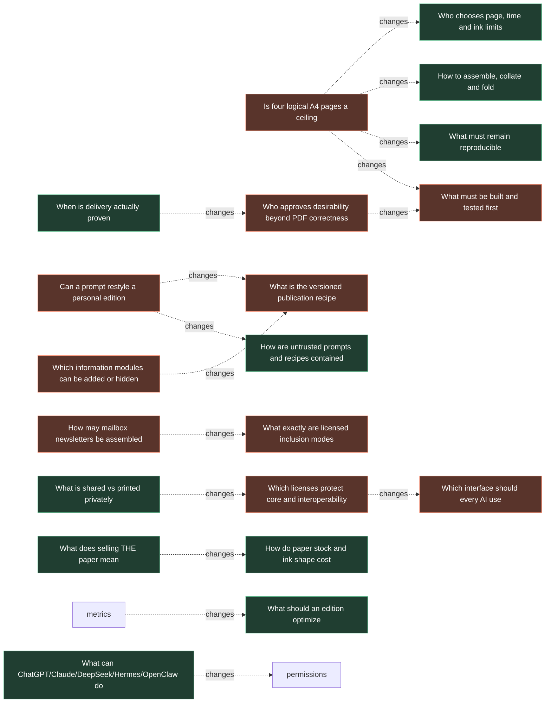

# Kuşluk — Owner's Decision Atlas

> **Snapshot: 19 October 2026 · 56 decision-map nodes · 47 question forks · 87 cross-links.**  
> Owner directive: [#170](https://github.com/interzettel/kushluk/issues/170). All unresolved branches require evidence and a recorded human decision; none is automatically accepted by being shown on this page.

## What this map is

This is an **opinionated navigation tree + dependency graph**, not a pretend exact binary decision algorithm. Parent/child edges are strategic categories. Dotted lines are where one choice changes requirements on another branch. Real design/architecture choices have alternatives, reversibility, impact and source links in the [structured JSON](decision-atlas.json). Prior ADRs, actual issue state and evidence remain authoritative.

**[Open the interactive atlas](decision-atlas.html)** by downloading the HTML file and opening it locally (offline; no external scripts or tracking). It contains its own data snapshot, pan/zoom, filter, clickable issues and impact arrows. Or use this native GitHub Mermaid diagram.

## The full strategic tree

```mermaid
flowchart LR
  classDef owner fill:#254a3f,stroke:#65ca9e,color:#ffffff,stroke-width:2px;
  classDef contested fill:#5d392b,stroke:#ef9c79,color:#ffffff,stroke-width:2px;
  classDef open fill:#2d3933,stroke:#7d9984,color:#ffffff;
  classDef research fill:#334151,stroke:#8cb1cf,color:#ffffff;
  NORTH["OWNER PROMISE • THE PAPER • Product promise"]:::owner
  click NORTH "https://github.com/interzettel/kushluk/issues/170" "Discuss NORTH"
  VALUE["DOMAIN • READER • Intent & meaning"]:::owner
  NORTH --> VALUE
  click VALUE "https://github.com/interzettel/kushluk/issues/6" "Discuss VALUE"
  PAPER["DOMAIN • ARTIFACT • Editions & format"]:::contested
  NORTH --> PAPER
  click PAPER "https://github.com/interzettel/kushluk/issues/171" "Discuss PAPER"
  ART["DOMAIN • ART DIRECTION • Visual language"]:::owner
  NORTH --> ART
  click ART "https://github.com/interzettel/kushluk/issues/159" "Discuss ART"
  SOURCE["DOMAIN • INPUTS • Private information & rights"]:::open
  NORTH --> SOURCE
  click SOURCE "https://github.com/interzettel/kushluk/issues/173" "Discuss SOURCE"
  AGENT["DOMAIN • AGENTS • Language to editions"]:::contested
  NORTH --> AGENT
  click AGENT "https://github.com/interzettel/kushluk/issues/174" "Discuss AGENT"
  OUTPUT["DOMAIN • DELIVERY • Reliable reading surfaces"]:::open
  NORTH --> OUTPUT
  click OUTPUT "https://github.com/interzettel/kushluk/issues/13" "Discuss OUTPUT"
  STUDIO["DOMAIN • STUDIO • Ecosystem & economics"]:::open
  NORTH --> STUDIO
  click STUDIO "https://github.com/interzettel/kushluk/issues/175" "Discuss STUDIO"
  GOV["DOMAIN • GOVERNANCE • One founder / three AIs"]:::owner
  NORTH --> GOV
  click GOV "https://github.com/interzettel/kushluk/issues/176" "Discuss GOV"
  audiences["Who is the first intended reader"]:::open
  VALUE --> audiences
  click audiences "https://github.com/interzettel/kushluk/issues/13" "Discuss audiences"
  finish["What should an edition optimize"]:::open
  VALUE --> finish
  click finish "https://github.com/interzettel/kushluk/issues/170" "Discuss finish"
  serendipity["How much editorial surprise and disagreement"]:::open
  VALUE --> serendipity
  click serendipity "https://github.com/interzettel/kushluk/issues/158" "Discuss serendipity"
  modules["Which information modules can be added or hidden"]:::contested
  VALUE --> modules
  click modules "https://github.com/interzettel/kushluk/issues/158" "Discuss modules"
  density["How should quiet vs full news days read"]:::open
  VALUE --> density
  click density "https://github.com/interzettel/kushluk/issues/160" "Discuss density"
  personal["How do private context and published stories coexist"]:::contested
  VALUE --> personal
  click personal "https://github.com/interzettel/kushluk/issues/161" "Discuss personal"
  length["Is four logical A4 pages a ceiling"]:::contested
  PAPER --> length
  click length "https://github.com/interzettel/kushluk/issues/171" "Discuss length"
  supplements["What are sports and Substack extra pages"]:::open
  PAPER --> supplements
  click supplements "https://github.com/interzettel/kushluk/issues/171" "Discuss supplements"
  imposition["How to assemble, collate and fold"]:::open
  PAPER --> imposition
  click imposition "https://github.com/interzettel/kushluk/issues/171" "Discuss imposition"
  budget["Who chooses page, time and ink limits"]:::open
  PAPER --> budget
  click budget "https://github.com/interzettel/kushluk/issues/171" "Discuss budget"
  archive["What must remain reproducible"]:::open
  PAPER --> archive
  click archive "https://github.com/interzettel/kushluk/issues/161" "Discuss archive"
  deadline["How do extra pages affect morning readiness"]:::open
  PAPER --> deadline
  click deadline "https://github.com/interzettel/kushluk/issues/171" "Discuss deadline"
  families["How many distinct authored visual families"]:::open
  ART --> families
  click families "https://github.com/interzettel/kushluk/issues/159" "Discuss families"
  prompt["Can a prompt restyle a personal edition"]:::contested
  ART --> prompt
  click prompt "https://github.com/interzettel/kushluk/issues/172" "Discuss prompt"
  images["Which image roles support real editorial meaning"]:::open
  ART --> images
  click images "https://github.com/interzettel/kushluk/issues/160" "Discuss images"
  typography["What is readable and culturally expressive"]:::open
  ART --> typography
  click typography "https://github.com/interzettel/kushluk/issues/159" "Discuss typography"
  art-accept["Who approves desirability beyond PDF correctness"]:::contested
  ART --> art-accept
  click art-accept "https://github.com/interzettel/kushluk/issues/168" "Discuss art-accept"
  styles-policy["May artistic styles be traded or shared"]:::open
  ART --> styles-policy
  click styles-policy "https://github.com/interzettel/kushluk/issues/38" "Discuss styles-policy"
  mail["How may mailbox newsletters be assembled"]:::contested
  SOURCE --> mail
  click mail "https://github.com/interzettel/kushluk/issues/173" "Discuss mail"
  timeline["What is permitted timeline intake"]:::open
  SOURCE --> timeline
  click timeline "https://github.com/interzettel/kushluk/issues/173" "Discuss timeline"
  substack["What happens to paid Substack content"]:::open
  SOURCE --> substack
  click substack "https://github.com/interzettel/kushluk/issues/173" "Discuss substack"
  rights["What exactly are licensed inclusion modes"]:::contested
  SOURCE --> rights
  click rights "https://github.com/interzettel/kushluk/issues/16" "Discuss rights"
  source-rights["What is shared vs printed privately"]:::open
  SOURCE --> source-rights
  click source-rights "https://github.com/interzettel/kushluk/issues/173" "Discuss source-rights"
  revoke["Can users revoke connections safely"]:::open
  SOURCE --> revoke
  click revoke "https://github.com/interzettel/kushluk/issues/173" "Discuss revoke"
  interop["Which interface should every AI use"]:::contested
  AGENT --> interop
  click interop "https://github.com/interzettel/kushluk/issues/174" "Discuss interop"
  agents["What can ChatGPT/Claude/DeepSeek/Hermes/OpenClaw do"]:::open
  AGENT --> agents
  click agents "https://github.com/interzettel/kushluk/issues/174" "Discuss agents"
  recipe["What is the versioned publication recipe"]:::contested
  AGENT --> recipe
  click recipe "https://github.com/interzettel/kushluk/issues/161" "Discuss recipe"
  safety["How are untrusted prompts and recipes contained"]:::open
  AGENT --> safety
  click safety "https://github.com/interzettel/kushluk/issues/174" "Discuss safety"
  autonomy["Which actions require reader authorization"]:::contested
  AGENT --> autonomy
  click autonomy "https://github.com/interzettel/kushluk/issues/174" "Discuss autonomy"
  fallback["How does publishing work without AI access"]:::open
  AGENT --> fallback
  click fallback "https://github.com/interzettel/kushluk/issues/174" "Discuss fallback"
  printer["Can an ordinary dusty printer really deliver"]:::open
  OUTPUT --> printer
  click printer "https://github.com/interzettel/kushluk/issues/47" "Discuss printer"
  print-proof["When is delivery actually proven"]:::open
  OUTPUT --> print-proof
  click print-proof "https://github.com/interzettel/kushluk/issues/168" "Discuss print-proof"
  ink["How do paper stock and ink shape cost"]:::open
  OUTPUT --> ink
  click ink "https://github.com/interzettel/kushluk/issues/36" "Discuss ink"
  digital["What does responsible scrolling mean"]:::open
  OUTPUT --> digital
  click digital "https://github.com/interzettel/kushluk/issues/33" "Discuss digital"
  proof["Which experiences get tested"]:::open
  OUTPUT --> proof
  click proof "https://github.com/interzettel/kushluk/issues/47" "Discuss proof"
  license["Which licenses protect core and interoperability"]:::contested
  STUDIO --> license
  click license "https://github.com/interzettel/kushluk/issues/175" "Discuss license"
  commerce["What does selling THE paper mean"]:::open
  STUDIO --> commerce
  click commerce "https://github.com/interzettel/kushluk/issues/175" "Discuss commerce"
  contributors["How do outside maintainers arrive"]:::open
  STUDIO --> contributors
  click contributors "https://github.com/interzettel/kushluk/issues/175" "Discuss contributors"
  film["How do we tell the paper-company story"]:::open
  STUDIO --> film
  click film "https://github.com/interzettel/kushluk/issues/175" "Discuss film"
  growth["What signals ecosystem adoption"]:::open
  STUDIO --> growth
  click growth "https://github.com/interzettel/kushluk/issues/175" "Discuss growth"
  ethics["Can we fund without user lock-in"]:::open
  STUDIO --> ethics
  click ethics "https://github.com/interzettel/kushluk/issues/175" "Discuss ethics"
  review["How do three AIs actually disagree"]:::open
  GOV --> review
  click review "https://github.com/interzettel/kushluk/issues/176" "Discuss review"
  door["Which decisions require an ADR"]:::open
  GOV --> door
  click door "https://github.com/interzettel/kushluk/issues/176" "Discuss door"
  milestones["What must be built and tested first"]:::contested
  GOV --> milestones
  click milestones "https://github.com/interzettel/kushluk/issues/169" "Discuss milestones"
  tracker["How to connect all the ledgers"]:::open
  GOV --> tracker
  click tracker "https://github.com/interzettel/kushluk/issues/176" "Discuss tracker"
  cadence["How does a solo founder avoid PM theater"]:::open
  GOV --> cadence
  click cadence "https://github.com/interzettel/kushluk/issues/176" "Discuss cadence"
  gates["How should we score delivery evidence"]:::open
  GOV --> gates
  click gates "https://github.com/interzettel/kushluk/issues/168" "Discuss gates"
```

## Cross-cutting blast radius — sample major dependencies

## Existing decisions with explicit conflict

| Decision | Currently authoritative | Proposed owner choice | Required change |
| --- | --- | --- | --- |
| **Logical paper pages** | [ADR 0013](../adr/0013-four-logical-a4-pages-multiple-print-profiles.md): four A4 pages | Finite supplements / variable-length issues | [R6 #171](https://github.com/interzettel/kushluk/issues/171), compatibility migration and reviewed ADR |
| **Runtime AI-generated layout** | [#31](https://github.com/interzettel/kushluk/issues/31) default rule: avoid unreviewed AI geometry | Prompt-to-*validated declarative recipes* | [R7 #172](https://github.com/interzettel/kushluk/issues/172), independent baseline/AI proof |
| **Source-mode authority** | Two accepted ADR 0012 files conflict | User-authorized mailbox/timeline/paid-content intake | [#44](https://github.com/interzettel/kushluk/issues/44) normative fix and [R8 #173](https://github.com/interzettel/kushluk/issues/173) permission matrix |
| **Agent integration** | CLI/workflows exist, broader interfaces proposed | Any authorized agent can compose safely for its own user | [R9 #174](https://github.com/interzettel/kushluk/issues/174), API/security/version tests |
| **Software rights and paid art** | Core currently MIT; future proposal in #38 | Open core, usable interop, original optional paper/packs | [#38](https://github.com/interzettel/kushluk/issues/38) decision and [R10 #175](https://github.com/interzettel/kushluk/issues/175) real economics |
| **Release ordering** | [#87](https://github.com/interzettel/kushluk/issues/87) / [draft PR #169](https://github.com/interzettel/kushluk/pull/169) | Reprioritize durable reader delight and safe agent creative use | [R5 #162](https://github.com/interzettel/kushluk/issues/162), [R11 #176](https://github.com/interzettel/kushluk/issues/176), founder ratification |

## All decisions and live discussion threads

### READER • Intent & meaning

| Decision | Status | Alternatives / choice | Authority |
| --- | --- | --- | --- |
| **audiences** · Who is the first intended reader | open research/choice | A) Home-printer morning reader / B) commuter/newsletter collector / C) general-purpose digital reader | [#13](https://github.com/interzettel/kushluk/issues/13) |
| **finish** · What should an edition optimize | open research/choice | A) Comprehension and finish / B) desire-to-hold/keep / C) time-on-platform (rejected hypothesis) | [#170](https://github.com/interzettel/kushluk/issues/170) |
| **serendipity** · How much editorial surprise and disagreement | open research/choice | A) User controls beats with serendipity budget / B) curated editorial floor / C) absolute hide controls | [#158](https://github.com/interzettel/kushluk/issues/158) |
| **modules** · Which information modules can be added or hidden | decision contested | A) Typed module configuration / B) visual home-screen canvas / C) small first-release presets | [#158](https://github.com/interzettel/kushluk/issues/158) |
| **density** · How should quiet vs full news days read | open research/choice | A) Honest short paper / B) expand only with valid extras / C) backfill arbitrary content (unacceptable) | [#160](https://github.com/interzettel/kushluk/issues/160) |
| **personal** · How do private context and published stories coexist | decision contested | A) Private profile and immutable edition / B) per-edition consent / C) never share private components in recipes | [#161](https://github.com/interzettel/kushluk/issues/161) |

### ARTIFACT • Editions & format

| Decision | Status | Alternatives / choice | Authority |
| --- | --- | --- | --- |
| **length** · Is four logical A4 pages a ceiling | decision contested | A) 4-page core + supplements / B) single bounded variable N-page edition / C) retain strictly four pages | [#171](https://github.com/interzettel/kushluk/issues/171) |
| **supplements** · What are sports and Substack extra pages | open research/choice | A) Tagged optional insert / B) extra section in longer edition / C) digital-only supplement | [#171](https://github.com/interzettel/kushluk/issues/171) |
| **imposition** · How to assemble, collate and fold | open research/choice | A) A4 simplex/duplex / B) A3 folded booklets / C) longer signatures / separate insert | [#171](https://github.com/interzettel/kushluk/issues/171) |
| **budget** · Who chooses page, time and ink limits | open research/choice | A) Reader-configurable budget / B) default bounded cap with override / C) platform-enforced fixed count | [#171](https://github.com/interzettel/kushluk/issues/171) |
| **archive** · What must remain reproducible | open research/choice | A) Immutable edition + asset hashes / B) content-linked ordered supplements / C) portable recipe and archive separate | [#161](https://github.com/interzettel/kushluk/issues/161) |
| **deadline** · How do extra pages affect morning readiness | open research/choice | A) Optional inserts run separately / B) deadline-based partial delivery / C) all-or-nothing extended edition | [#171](https://github.com/interzettel/kushluk/issues/171) |

### ART DIRECTION • Visual language

| Decision | Status | Alternatives / choice | Authority |
| --- | --- | --- | --- |
| **families** · How many distinct authored visual families | open research/choice | A) Several curated layouts / B) one excellent baseline then expand / C) open arbitrary design plugins | [#159](https://github.com/interzettel/kushluk/issues/159) |
| **prompt** · Can a prompt restyle a personal edition | decision contested | A) Prompt to bounded declarative style recipe / B) reviewed sandbox template package / C) map prompt to preset controls | [#172](https://github.com/interzettel/kushluk/issues/172) |
| **images** · Which image roles support real editorial meaning | open research/choice | A) Original/authorized documentary photos / B) illustrative or chart-led pieces / C) optional printmaking filters | [#160](https://github.com/interzettel/kushluk/issues/160) |
| **typography** · What is readable and culturally expressive | open research/choice | A) Licensed multilingual type families / B) contrasting art-directed grids / C) monochrome/low-ink equivalence | [#159](https://github.com/interzettel/kushluk/issues/159) |
| **art-accept** · Who approves desirability beyond PDF correctness | decision contested | A) Founder art-direction approval / B) independent blinded print trial / C) geometry CI as necessary but insufficient | [#168](https://github.com/interzettel/kushluk/issues/168) |
| **styles-policy** · May artistic styles be traded or shared | open research/choice | A) Safe recipe files / B) independently licensed original packs / C) trusted plugin boundaries | [#38](https://github.com/interzettel/kushluk/issues/38) |

### INPUTS • Private information & rights

| Decision | Status | Alternatives / choice | Authority |
| --- | --- | --- | --- |
| **mail** · How may mailbox newsletters be assembled | decision contested | A) Consented provider adapter / B) local EML/export import / C) reference/link-only digest | [#173](https://github.com/interzettel/kushluk/issues/173) |
| **timeline** · What is permitted timeline intake | open research/choice | A) Official scoped APIs / B) reader-exported bookmarks / C) bounded agent-selected public signals | [#173](https://github.com/interzettel/kushluk/issues/173) |
| **substack** · What happens to paid Substack content | open research/choice | A) Eligible private compilation with provenance / B) summary and source link / C) block when reproduction rights unclear | [#173](https://github.com/interzettel/kushluk/issues/173) |
| **rights** · What exactly are licensed inclusion modes | decision contested | A) Direct content with permission / B) traceable excerpt/summary / C) metadata-only reference | [#16](https://github.com/interzettel/kushluk/issues/16) |
| **source-rights** · What is shared vs printed privately | open research/choice | A) Source-rights tagged per component / B) private only authorized direct copy / C) public recipes exclude bodies | [#173](https://github.com/interzettel/kushluk/issues/173) |
| **revoke** · Can users revoke connections safely | open research/choice | A) Local per-source pause/revoke / B) explicit deletion/retention / C) independent agent permission receipts | [#173](https://github.com/interzettel/kushluk/issues/173) |

### AGENTS • Language to editions

| Decision | Status | Alternatives / choice | Authority |
| --- | --- | --- | --- |
| **interop** · Which interface should every AI use | decision contested | A) Versioned JSON CLI / B) bounded local MCP surface / C) authenticated localhost API | [#174](https://github.com/interzettel/kushluk/issues/174) |
| **agents** · What can ChatGPT/Claude/DeepSeek/Hermes/OpenClaw do | open research/choice | A) Compose validated draft / B) propose durable preferences / C) deliver only under explicit grant | [#174](https://github.com/interzettel/kushluk/issues/174) |
| **recipe** · What is the versioned publication recipe | decision contested | A) Declarative layout/module/style without private content / B) private reader profile / C) immutable edition identity | [#161](https://github.com/interzettel/kushluk/issues/161) |
| **safety** · How are untrusted prompts and recipes contained | open research/choice | A) No executable code in untrusted recipes / B) sandbox reviewed plugins / C) strict permissions and receipts | [#174](https://github.com/interzettel/kushluk/issues/174) |
| **autonomy** · Which actions require reader authorization | decision contested | A) Inspect/preview by default / B) bounded standing morning grant / C) confirm first physical/email delivery | [#174](https://github.com/interzettel/kushluk/issues/174) |
| **fallback** · How does publishing work without AI access | open research/choice | A) Deterministic local preset / B) cached licensed approved content / C) no fabricated filler | [#174](https://github.com/interzettel/kushluk/issues/174) |

### DELIVERY • Reliable reading surfaces

| Decision | Status | Alternatives / choice | Authority |
| --- | --- | --- | --- |
| **printer** · Can an ordinary dusty printer really deliver | open research/choice | A) Windows queue bridge / B) CUPS on supported hosts / C) manual fallback when offline | [#47](https://github.com/interzettel/kushluk/issues/47) |
| **print-proof** · When is delivery actually proven | open research/choice | A) Validated software PDF / B) spool submission not physical proof / C) operator real-sheet acceptance | [#168](https://github.com/interzettel/kushluk/issues/168) |
| **ink** · How do paper stock and ink shape cost | open research/choice | A) Great monochrome baseline / B) optional color/halftone / C) premium papers with known cost | [#36](https://github.com/interzettel/kushluk/issues/36) |
| **digital** · What does responsible scrolling mean | open research/choice | A) Finite scroll with final page / B) static EPUB / C) optional audio—not engagement feed | [#33](https://github.com/interzettel/kushluk/issues/33) |
| **proof** · Which experiences get tested | open research/choice | A) Paper desirability and comprehension / B) layout/rights accessibility / C) 5-morning reliable delivery | [#47](https://github.com/interzettel/kushluk/issues/47) |

### STUDIO • Ecosystem & economics

| Decision | Status | Alternatives / choice | Authority |
| --- | --- | --- | --- |
| **license** · Which licenses protect core and interoperability | decision contested | A) Keep MIT / B) MPL core + permissive clean SDK / C) evaluate AGPL/GPL | [#175](https://github.com/interzettel/kushluk/issues/175) |
| **commerce** · What does selling THE paper mean | open research/choice | A) Optional excellent paper products / B) optional original art packs / C) licensed paid fulfillment later | [#175](https://github.com/interzettel/kushluk/issues/175) |
| **contributors** · How do outside maintainers arrive | open research/choice | A) Approachable tasks + tests / B) portable recipe community / C) transparent governance and contribution policy | [#175](https://github.com/interzettel/kushluk/issues/175) |
| **film** · How do we tell the paper-company story | open research/choice | A) Original warm editorial film / B) playful absurd paper-commercial cut / C) no unlicensed The Office footage/marks | [#175](https://github.com/interzettel/kushluk/issues/175) |
| **growth** · What signals ecosystem adoption | open research/choice | A) First useful edition / B) repeat print completion / C) community reuse—not stars alone | [#175](https://github.com/interzettel/kushluk/issues/175) |
| **ethics** · Can we fund without user lock-in | open research/choice | A) Free complete open core / B) optional original materials / C) no centrally monetized reader data | [#175](https://github.com/interzettel/kushluk/issues/175) |

### GOVERNANCE • One founder / three AIs

| Decision | Status | Alternatives / choice | Authority |
| --- | --- | --- | --- |
| **review** · How do three AIs actually disagree | open research/choice | A) Independent first-round briefs / B) cross-critiques with evidence / C) founder verdict including dissent | [#176](https://github.com/interzettel/kushluk/issues/176) |
| **door** · Which decisions require an ADR | open research/choice | A) Reversible prototypes fast / B) one-way contracts formal decision / C) preserve supersession history | [#176](https://github.com/interzettel/kushluk/issues/176) |
| **milestones** · What must be built and tested first | decision contested | A) Value/beauty prototype before scaling / B) small semantic recipe spine / C) parallel reliability evidence | [#169](https://github.com/interzettel/kushluk/issues/169) |
| **tracker** · How to connect all the ledgers | open research/choice | A) One issue inventory #43 / B) decision atlas with ADR/feature links / C) no fabricated completion percentages | [#176](https://github.com/interzettel/kushluk/issues/176) |
| **cadence** · How does a solo founder avoid PM theater | open research/choice | A) Weekly decision windows / B) independent async agent review / C) work-in-progress limits per shared subsystem | [#176](https://github.com/interzettel/kushluk/issues/176) |
| **gates** · How should we score delivery evidence | open research/choice | A) Existing G1–G8 independently / B) new editorial rubric separately / C) never promote simulated CI to real-paper acceptance | [#168](https://github.com/interzettel/kushluk/issues/168) |

## How to use the atlas as an operating system

1. **Pick a high-blast-radius disputed node** (e.g. `length`, `prompt`, `rights`, `interop`, `license`, `milestones`). Read its cited ADR/feature/issue, alternatives and proof.
2. **Gather three attributable independent AI analyses** (ChatGPT, Claude, local DeepSeek) followed by cross-examination. Each independently considers *all* product, technical, design, copyright, privacy and commercial impacts—not one predefined job title. **No agent consensus exists before their real comments arrive.**
3. **Founder rules with rationale** in the owning discussion: `ACCEPT / AMEND / EXPERIMENT / DEFER / REJECT`. Identify compatibility migration, affected ADRs, F-IDs, stage, tests, reversibility and uncertainty.
4. **For a durable contract:** open a reviewed ADR/doc delta PR before production merges. For a reversible experimental concept: make a scoped branch and a fixture/prototype, not an unsupported roadmap commitment.
5. **Build and validate in two streams:** (a) attractiveness/usefulness/source permissions/reader comprehension; (b) deterministic code, printing, setup and reliability. Do not let passing CI substitute for delight.
6. **Update existing authorities, not a competing backlog:** [#43 complete issue catalogue](https://github.com/interzettel/kushluk/issues/43) → [#87 feature/release map](https://github.com/interzettel/kushluk/issues/87) → `docs/WORK_LEDGER.md` stable 90 task IDs → `docs/PROGRESS.md` independent G1–G8 delivery gates.

**Owner-approved vs open:** The personal, beautiful, finite publishing ambition is affirmed in [#170](https://github.com/interzettel/kushluk/issues/170). Page counts, prompt execution boundary, license, agent API, new styles and milestone changes are **still open for formal deliberation**. Existing hardware tests are not undone.

## Governance sources

[Owner #170](https://github.com/interzettel/kushluk/issues/170) · [Decision council #157](https://github.com/interzettel/kushluk/issues/157) · [R1–R5](https://github.com/interzettel/kushluk/issues/158) · [R6–R11](https://github.com/interzettel/kushluk/issues/171) · [Governance #43](https://github.com/interzettel/kushluk/issues/43) · [Release owner #87](https://github.com/interzettel/kushluk/issues/87) · [License RFC #38](https://github.com/interzettel/kushluk/issues/38) · [Launch film #11](https://github.com/interzettel/kushluk/issues/11). 
