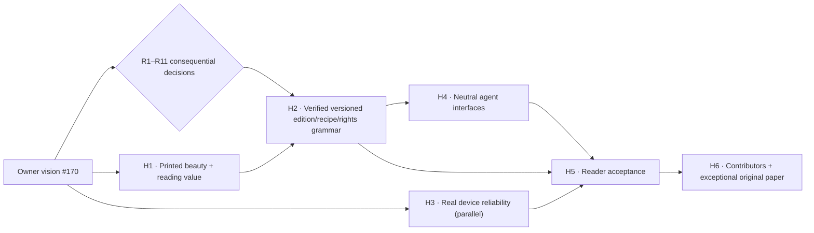

# Product sequencing RFC — prove the publication before scaling the platform

**Proposal, not an approved rebaseline** · 19 October 2026. Owner direction [#170](https://github.com/interzettel/kushluk/issues/170), [decision atlas](DECISION_ATLAS.md), [decision council #157](https://github.com/interzettel/kushluk/issues/157), [R6–R11](https://github.com/interzettel/kushluk/issues/171). The current accepted edition contract remains ADR 0013 (four logical A4 pages), and current versions/milestones live under [#87](https://github.com/interzettel/kushluk/issues/87). Draft [PR #169](https://github.com/interzettel/kushluk/pull/169) proposes a narrower pre-beta design-quality checkpoint; this RFC **expands the debate** after the founder's broader vision. Do not silently merge both incompatible planning proposals.

## Stop treating engineering throughput as product progress

The key bottleneck for a solo founder using strong coding agents is no longer writing hundreds of lines of code. It is knowing **which experience is valuable**, **which decisions are irreversible**, **which visual direction deserves the paper** and **which proofs would change our minds**.

Treat completed code, finished human-readable product design, source rights, genuinely working printers, interoperable agents, and an explicitly versioned plan as distinct dimensions. Passing PDF geometry CI is not proof that somebody enjoys the newspaper. Conversely, a gorgeous speculative film does not show functioning permissions or a working physical morning.

### North-star outcome criteria (candidate measurement plan)

| Outcome | Evidence the founder should actually inspect | Failure that should stop or redirect investment |
| --- | --- | --- |
| **Desire to hold and read** | Original, rights-cleared, meaningful articles plus real images; several visually distinct compositions **printed at full scale** and compared blind/side-by-side. | Readers consistently prefer reading the same content on an ordinary website or feel the paper adds friction with no value. |
| **Finite comprehension** | User-selected topic and reading budget; after reading, people can recall the claims and confidently reach an end. | An endless-scroll/notification UX performs better on engagement metrics only because it is addictive. |
| **Real reader control** | Three distinct reader-defined modules/styles on the same source day; sources/privacy remain separate from shareable design recipes. | Configurations leak personal content, destroy readable layout or require daily manual editing. |
| **Agent-usable engine** | A generic independent agent client uses documented inspect → draft → validate → archive API without proprietary prompt hacks. | It only works from one privileged IDE session or has ambiguous permissions to read/print. |
| **Practical physical delight** | A dusty ordinary printer produces and correctly collates a beautiful page or supplement in actual conditions; true hardware/sleep/failure receipts. | Good-looking screenshots depend on expensive ink, special stock or frequent failed/doubled print jobs. |
| **Sustainable open ecosystem** | New maintainers can inspect accepted decisions and make tested, rights-safe improvements; optional paper economics based on real purchases. | Optional commerce erodes core features, privacy, interoperability or developer trust. |

### Proposed outcome-led sequence (not new official milestone codes)

| Candidate horizon | Experiment first | Engineering after evidence | Decision/review owners | Exit evidence | Track status |
| --- | --- | --- | --- | --- | --- |
| **H0 — Founder's north star** | Challenge four-page universality, art/reader promises, mailbox rights, AI prompt limits, external agents, paper commerce. | Only reversible research and documentation until new ADR authorizations. | #170; R1–R11; #157; #38 and #44 remain source authorities. | Three attributed independent reviews on consequential decisions; founder verdict on at least critical page/recipe/rights contracts. | **DISCUSSING** |
| **H1 — The desired object** | Freeze lawful/original, substantial content and images; produce 3 meaningfully different printed artifacts and a sports-insert mockup; test keep/read/finish. | Offline art-direction and original-author fixture tools; no dependency on full ingestion or cloud infra. | A01 #163, A02 #164, A06 #168, #159/#160 and R6 #171. | Owner selects/rejects genuine physical designs and records why; paper/ink economics and readability audited. | **SPIKE READY** |
| **H2 — Publication grammar** | Compare one 4-page paper with optional insert against bounded N-page edition; compare prompt-created recipe against curated gallery; three readers choose modules/styles. | Versioned semantic story/media/rights/asset IDs, private preferences, safe visual recipe and page/section manifest. Then deterministic render/migration/validator. | R1 #158, R4 #161, R6 #171, R7 #172; A03 #165 and later A04 #166/A05 #167. | Accepted ADR/schema and archive migration *if* changed; reproducible real PDF, safe text/asset/rights fallbacks. | **BLOCKED ON DECISION** |
| **H3 — One trustworthy real morning** | Reader configures sources and gets printed/saved edition with explicit consent, ideally automatically and no double print. | Stable staged pipeline; queue/driver bridge; print + archival idempotency; deadline/restart/host observability. | Existing #13/#46/#47 and G1–G8. | Real user host, actual paper, independent novice and source-rights evidence; not just a process exit. | **IN PARALLEL** |
| **H4 — Any authorized agent can publish** | Two genuinely separate client runners use **the same neutral contract** to prepare and safely preview an issue; confirm durable preferences and privacy. | JSON CLI first and optional MCP/local authenticated API depending on R9; external apps use replaceable capability-bound adapters. | R8 #173, R9 #174, #15/#20, #5. | Independent client and security/permission tests; no implied actual Claude/ChatGPT/OpenClaw plugin integration. | **PROPOSAL** |
| **H5 — Responsible invite-only beta** | Real readers choose a beautiful style and content modules, read an edition and report failure/keep/finish. | Hardened installation, native delivery, rights/revocation, migration, failure states and traceability. | #87 release owner, R5 #162, #43, G1–G8. | Founder/art direction + actual product acceptance + existing legal/security/hardware gates; release scope explicitly set. | **PENDING REBASELINE** |
| **H6 — Ecosystem and THE PAPER** | Community designs, contribution pilots, original paper/packs and optional fulfillment priced with realistic costs. | Stabilize SDK/theme portability, contributor contracts, OSS/legal/licensing and original content marketplace only if demand exists. | R10 #175, #36/#38, #23/#11 launch. | Maintainers/users contributing meaningful value, lawful original art, voluntary demand; no lock-in. | **RESEARCH ONLY** |

**Parallelism is intentional:** H1 art studies and H3 field reliability can operate simultaneously with H0 decisions, provided no agent modifies the frozen local WSL2 trial or pretends unreviewed schemas are public commitments. H1 does **not** require live mailbox access or publishing proprietary newsletter text. H2 irreversible code migrations wait for explicit owner/ADR rulings, whereas isolated research can move immediately.

## The critical path is not a release-number sequence

These H0–H6 labels are **proposal discussion horizons**. Do not confuse them with approved M0–M6 release milestones. Impact on stable 32 F-IDs and checked original 90 tasks is traceable through [IMPACT_MATRIX.md](IMPACT_MATRIX.md). Founder must decide precise deltas with review via [R5 #162](https://github.com/interzettel/kushluk/issues/162) and [R11 #176](https://github.com/interzettel/kushluk/issues/176); any accepted planning change gets its own reviewed PR under [#87](https://github.com/interzettel/kushluk/issues/87). Current feature catalogue and work ledger remain authoritative.

## Product management / test portfolio — less ceremony, better decisions

**Question backlog:** keep high-consequence uncertainties as R-issues. Each has a clear fork, competing options, best case against each, source evidence, and proof that could reverse the answer.

**Experiment backlog:** create or use one small issue and one isolated PR/fixture per *falsifiable* assumption. No requirement to create issues for every sentence. Stop experiments explicitly when evidence rejects their hypothesis.

**Implementation backlog:** after approved contract, split actual code changes by stable files/interfaces with typed outputs, negative tests, a source-rights boundary and reproducible validation. Use existing epic owners and [#43](https://github.com/interzettel/kushluk/issues/43). AI peers aren't narrow fixed roles; the **work item**, not the model, has a boundary.

**Evidence backlog:** product desirability, source-rights safety, content integrity, human comprehension, real paper and host reliability need independent receipts. Existing G1–G8 remain unchanged and are not substituted by newly invented success percentages.

**One founder cadence:** up to 1–3 consequential decisions per week; keep 1–2 reversible original-art/reader tests in flight, one production integration PR per shared subsystem, and a short weekly chart of open critical risks/blocked contracts/paper proofs. Fast changes are fine when clearly reversible. Founder's taste and customer use—not the number of green test ticks—decide what belongs in the release.

## Highest-blast-radius decisions to discuss first

1. **R6 #171:** whether an immutable *edition* can have supplements or N pages, with archive/format migration cost.
2. **R7 #172 and R4 #161:** the prompt→safe recipe contract and what is allowed to vary without changing story truth or executing untrusted templates.
3. **R8 #173:** legal/technical scope of user-authorized mail/newsletter/timeline assembly; source rights are not implementation polish.
4. **R9 #174:** smallest neutral agent interface and separate explicit delivery permissions.
5. **R2 #159:** actual art direction, editorial narrative, photographic roles, print quality, and minimum human visual acceptance before beta.
6. **R10 #175 / #38:** core software/SDK/original goods/trademark split—important but need not block art or semantic-engine experimentation.

Do **not** prioritize changing business entities, auto-generating a hundred PRs or building a full dynamic workspace before proving actual beautiful printed content and safe semantic transforms.
